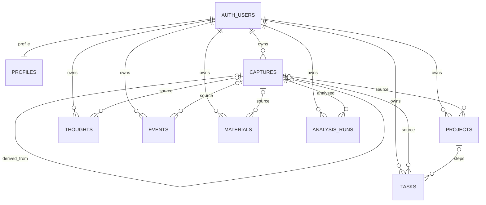

# Предметная модель базы «Сброс»

Облачная база нормализована по сущностям продукта. JSON используется в транспортном контракте RPC; основные поля хранятся в отдельных типизированных колонках PostgreSQL. Локальный источник данных — Room, синхронизация не требует постоянного подключения.

## ER-диаграмма

`AUTH_USERS` — управляемая Supabase таблица `auth.users`. У вручную созданных записей источник необязателен. При подтверждении разбора у каждого результата сохраняется `capture_id` исходного сброса.

## Сущности

| Таблица | Основные предметные поля |
|---|---|
| `profiles` | `user_id`, `display_name`, `created_at`, `updated_at` |
| `captures` | `raw_text`, `source`, `status`, `confirmed_at`, `parent_capture_id`, `analysis_model`, `analysis_commit` |
| `projects` | `title`, `area`, `outcome`, `capture_id` |
| `tasks` | `title`, `area`, `energy`, `hint`, `status`, `due_date`, `completed_at`, `project_id`, `capture_id` |
| `thoughts` | `title`, `body`, `thought_type`, `entry_time`, `is_favorite`, `source_text`, `capture_id` |
| `events` | `title`, `description`, `event_date`, `event_time`, `capture_id` |
| `materials` | `title`, `body`, `capture_id` |
| `analysis_runs` | `model`, `status`, `finished_at`, `proposal_count`, `error_code`, `capture_id` |

Все таблицы записей, кроме `profiles`, имеют `user_id`, `id` (UUID), `created_at`, `updated_at`, `deleted_at`, `version`, `change_id`. У результатов ИИ также есть отдельные колонки `analysis_model` и `source_excerpt`. Запись с `deleted_at` скрывается в приложении, но остаётся доступной протоколу передачи удалений.

Первичный ключ — `(user_id, id)`. Это позволяет перенести локальную запись в разные аккаунты по явному согласию, сохранив UUID и не смешивая владельцев. Составные внешние ключи включают `user_id`: задача не может ссылаться на проект или исходник другого пользователя.

## Как это соответствует интерфейсу

- **Дела** — `tasks.status = next`; ожидания, «когда-нибудь» и сделанные дела находятся в той же таблице со статусами `waiting`, `someday`, `done`.
- **Шаг проекта** — та же строка `tasks`, у которой заполнен `project_id`. Выполнение/редактирование отражается и в проекте, и в общем списке.
- **Состояние проекта** — `projects.completed_at`: NULL означает активный проект, дата — явное завершение пользователем. `completion_ready` хранит предложение завершить проект после фактического выполнения всех шагов; удаление или перенос последнего незавершённого шага его не создаёт. Для прежних записей NULL в этом поле означает вычисление по имеющимся шагам. Выполненные шаги сохраняются. Возврат шага в работу возвращает в работу и проект. Миграция 006 не меняет завершение старых проектов автоматически.
- **Мысли** — `thoughts`, тип `idea` или `diary`. Избранное хранится отдельно от типа.
- **Календарь** — события `events` плюс задачи с `due_date`. `calendar_entries` — представление, а не отдельная копия этих записей. На Android календарь собирается из Room, поэтому доступен без сети.
- **Входящие** — `captures.status = inbox`.
- **Обзор** — выборки по основным таблицам; отдельная таблица для экрана не нужна.
- **Плашка актуальности задач** — напоминание с галочкой только в интерфейсе. Отдельного сценария, дат, истории и таблицы нет. Миграция 004 удаляет прежнюю `weekly_reviews` и её ветку синхронизации.
- **История сбросов** — исходники `captures` и связанные результаты. Текст исходника не перезаписывается при изменении результата.

Даты сроков/событий имеют тип `date`, время события — nullable `time`, служебные моменты — `timestamptz`. В интерфейсе используется ДД.ММ.ГГГГ; транспорт дат — ISO YYYY-MM-DD.

## Журнал ИИ

После завершения попытки записываются модель, начало (`created_at`), окончание (`finished_at`), количество полученных предложений и итог:

- `succeeded` — проверенный ответ получен и сохранён для редактирования;
- `failed` — ошибка провайдера, формата или локального сохранения;
- `cancelled` — пользователь ушёл с обработки или отменил её.

Коды ошибок ограничены: `provider_error`, `invalid_response`, `storage_error`, `cancelled`. Ключи, промпты и сырые ответы в журнал не попадают. Получение предложений не означает их подтверждение: результаты записываются только отдельной транзакцией после нажатия пользователем кнопки.

Журнал относится к завершённым попыткам. При принудительном завершении процесса до записи итога строка попытки может отсутствовать; исходный сброс остаётся сохранённым. Автоматического повторного платного запроса нет. Ручная сортировка не создаёт запись об обращении к ИИ.

## Синхронизация

Android обращается к `sync_push_v3` и `sync_pull_v3` для обычных изменений, к `sync_confirm_capture_v1` для первого подтверждения разбора (миграция 005). Формат обмена сохраняет поля `kind` и `payload`, но RPC раскладывает их в предметные колонки. Маппинг:

| Локальный kind | Облачная таблица |
|---|---|
| `capture` | `captures` |
| `project` | `projects` |
| `action` | `tasks` |
| `thought` | `thoughts` |
| `event` | `events` |
| `reference` | `materials` |
| `analysis_run` | `analysis_runs` |

`sbros_sync_projection_v3` собирает представление для чтения и ответа RPC. Поля `dueDate`, `project_id`, источник, модель и идентификатор подтверждения не теряются на границе контрактов.

1. Изменение несёт UUID, базовую `version` и уникальный `change_id`.
2. Сервер определяет владельца по JWT (`auth.uid()`), а не по присланному `user_id`.
3. Совпавший `change_id` означает безопасный повтор уже принятой мутации.
4. Несовпавшая базовая версия возвращает конфликт, сохраняя обе копии на устройстве.
5. Успешная запись увеличивает версию. Запрос обрабатывается в транзакции и под блокировкой одного владельца.
6. Внешние ключи проверяются к завершению транзакции: связанные записи можно передавать одной пачкой. Между пачками клиент отправляет исходники и проекты перед результатами.
7. Чтение постранично получает все записи владельца, включая пометки удаления.

Миграция переносит UUID/версии из старого хранилища, поэтому очистка Room не нужна. Подтверждение разбора атомарно в Room. Последующая отправка в облако объединяет исходник и новые результаты в одну транзакцию. Сначала проверяется версия и идентификатор подтверждения исходника; при конфликте второй набор результатов не записывается. Повтор запроса после потери ответа использует те же UUID и change_id. Для всех RPC изменения одного пользователя сериализуются транзакционной блокировкой.

При конфликте разбора клиент сохраняет обе версии и локальные результаты в истории. Пользователь может оставить облачный вариант или вернуть локальный разбор во входящие как новый исходник с предложениями для повторного подтверждения. Непереданные результаты конфликтующего разбора убираются с рабочих экранов; их архив остаётся локально. Это правило не меняет завершение проектов.

## Доступ и ограничения

- На каждой предметной таблице включена RLS; чтение разрешено только владельцу.
- У `anon` нет доступа к данным. У `authenticated` нет прямой записи в предметные таблицы: изменения проходят через RPC с проверкой версии.
- RPC записи имеет `security definer`, пустой `search_path`, белый список типов, ограничения размеров и явную проверку владельца. Клиент не передаёт имя произвольной таблицы или SQL.
- Представления используют `security_invoker=true` и политики исходных таблиц (PostgreSQL 15+).
- Триггер защищает UUID, владельца, дату создания и исходный текст сброса. Административная правка результата также получает новую версию и мутацию.
- Удаление пользователя Auth удаляет его предметные строки через FK; обычное удаление записи приложением мягкое. Автоматическая физическая очистка tombstones не реализована.
- Настройки оформления, ключ ИИ, токены сессии, черновик и предложения до подтверждения не являются предметными облачными таблицами. Профиль создаётся существующим триггером регистрации Auth.

Официальные основания: [RLS и безопасные представления](https://supabase.com/docs/guides/database/postgres/row-level-security), [привилегии функций](https://supabase.com/docs/guides/database/functions).

SQL подготовлен для применения пользователем; выполнение и проверка живого Supabase в этой сессии не проводились.
